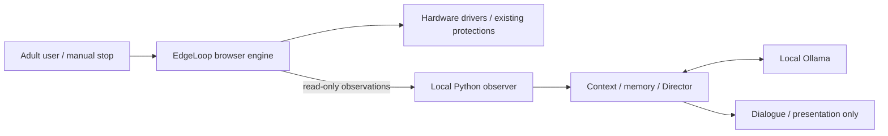

# EdgeLoop AI — experimental release candidate

EdgeLoop AI adds a local AI companion to [EdgeLoop by marshallmims](https://github.com/marshallmims/edgeloop), based on version 1.1.3, upstream commit `d351e011249079b368ebdc8d46f83b260be7d2a5`. It is experimental software intended for adults. This source release candidate is maintained by Prunebrother at https://github.com/Prunebrother/edgeloop-ai. It has not been verified for physical safety.

The original browser engine controls biofeedback sessions and hardware. The AI receives read-only observations, provides local Ollama dialogue, and uses a bounded Conversation Director. Story Memory is isolated by character/model. Session Journal recording and historical AI access require separate opt-ins. Experimental Director initiative is off by default.

Fictional demonstration: a simulator reports 98 BPM, an idle session and no connected toys. These values are test inputs, not a person's measurements. Use [simulation-first verification](INSTALL.md) before considering hardware.

Linux, Python 3.12+, Node 22+ for tests, an up-to-date Chromium browser and Ollama are needed for full local development. Browser hardware APIs require localhost or a secure context. Available RAM/VRAM must accommodate the chosen model and context; no universal minimum or latency guarantee is established. Referenced 8B/9B models are substantial downloads, installed separately.

Character definitions and lore are preserved unchanged. Character art and model weights are not shipped. Missing portraits use the existing fallback. See [model and asset boundaries](MODELS_AND_ASSETS.md), [licensing](THIRD_PARTY_NOTICES.md), [safety](SAFETY.md), [privacy](PRIVACY.md), [known issues](KNOWN_ISSUES.md), and [validation](VALIDATION.md).

The project has no automatic session-upload feature added by this release. The browser still loads external scripts and offers optional network device/peer features; see PRIVACY.md. Original usage guidance and acknowledgments are retained in [upstream documentation](docs/upstream/README.md). Its first-person statements and historical compatibility reports belong to upstream, not to the fork maintainers. This fork is not an upstream release or endorsement.

Source is AGPL-3.0-only; retain LICENSE and attribution. [Publication checklist](PUBLICATION_CHECKLIST.md) records publication authorization, checks and remaining limitations. This repository publishes source only; no running application is hosted.
